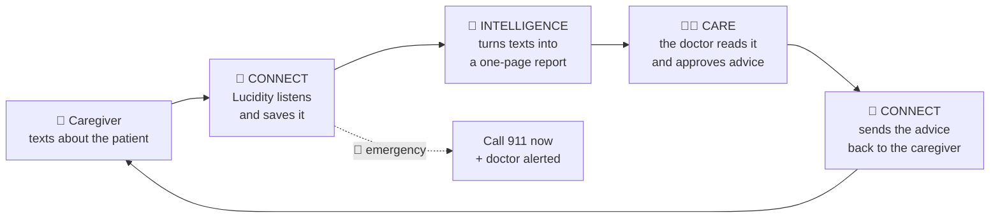

# Lucidity

**Connected dementia care, delivered over iMessage.**

Lucidity keeps the family caregiver and the care team connected between clinic visits. Caregivers text what they notice, as it happens. Lucidity turns those messages into a structured, clinically grounded record built on two established instruments, the NPI-Q (behavior) and the Zarit Burden Interview (caregiver strain), and sends clinician-approved guidance back to the family. No app to download.

> Built at HackNC 2026. All demo data is synthetic.

## 🧠 What Lucidity solves

> **Dementia care happens at home, but doctors only see the patient for a few minutes every few months, so they rely on what an exhausted caregiver can remember.**
> **Lucidity lets caregivers simply text what they notice, and turns those messages into a clear picture the care team can act on.**

### Three layers

<div align="center">

**💬 Connect** → **🧠 Intelligence** → **👩‍⚕️ Care**

| 💬 Connect | 🧠 Intelligence | 👩‍⚕️ Care |
|:---:|:---:|:---:|
| talks with the family | understands what's happening | the clinician decides |

</div>

## How Lucidity works



- **Connect**: Lucidity talks with the family by text.
- **Intelligence**: Lucidity turns all those texts into one simple report.
- **Care**: a doctor reads the report and decides what advice to send back.
- **Emergencies**: Lucidity says "call 911" right away and alerts the doctor.

**Going deeper:** [docs/CONTEXT.md](docs/CONTEXT.md) covers the why (problem, design rules, what's real vs. simulated, what's next). [docs/HOW_IT_WORKS.md](docs/HOW_IT_WORKS.md) covers the how (what happens to every text, each feature, the code map, running the demo, gotchas).

---

## What's built

The whole loop runs over iMessage today, with two phones: the caregiver's and a clinician's (labeled "Simulated clinician" in the demo).

```
Caregiver texts ──▶ CONNECT ──▶ INTELLIGENCE ──▶ CARE ──▶ CONNECT ──▶ Caregiver
                    safety first,  profile compiled  clinician reads,   delivers the
                    follow-ups,    by code: changes,  asks, approves     approved text,
                    check-ins,     quotes, suggested  the exact wording  saves the reply
                    reminders      questions, drafts
```

| | What works | Code / docs |
|---|---|---|
| **Safety** | Every text is checked by fixed rules before any AI sees it (stroke signs, breathing trouble, unresponsive, chest pain, seizure, falls, missing person, risk of harm, overdose, sudden confusion, not eating or drinking, fever, caregiver crisis). Fixed 911 / doctor / 988 wording; the AI can flag what the rules miss, but the reply is still fixed text. Routine reminders pause for an hour. The care team is alerted with the caregiver's exact words | `src/triage.ts` |
| **Welcome** | A warm two-message welcome the first time a caregiver texts, ending with "What can I do for you today?" (AI-written, checked by code) | `src/welcome.ts` |
| **Conversation** | Caregivers text naturally; GLM-5.3 saves observations with their exact words through validated tool calls, asks one follow-up at a time. A 10-second window groups bursts of texts. Code guardrails stop it from claiming saves or reminders that didn't happen, or changing records unasked | `src/agent.ts`, `src/prompt.ts` |
| **Clinical check-ins** | When patterns appear, Lucidity offers the NPI-Q (behavior) or Zarit Burden Interview items 1 to 12 (caregiver strain), hands off to word-for-word questions, understands casual answers, and scores in code. Incomplete forms get no made-up total | `src/questionnaire.ts`, `src/instruments/` |
| **Reminders** | "Remind me to give Dad his meds at 8pm" is texted at 8pm; one-time, daily, weekly. After a first check-in, Lucidity offers recurring check-in reminders (NPI-Q every 4 weeks, ZBI every 2 weeks). Times and time zones are computed by code | `src/reminders.ts` |
| **Care loop** | The clinician texts "how is he doing?" and gets a long-term profile (NPI-Q and ZBI changes between check-ins, the caregiver's words, alerts, up to 3 suggested questions with a reason for each). "ask 1" or "tell them: …" makes a draft; Lucidity rewrites clinician notes in caregiver-friendly wording; nothing is sent until the clinician approves the exact text; the caregiver's reply is saved and forwarded back | `src/care.ts`, `src/profile.ts`, `src/drafting.ts` |
| **Consent** | STOP silences everything routine (reminders are held, not deleted); START turns it back on. Care-team messages are not sent to an opted-out caregiver, and the clinician is told | `src/index.ts`, `src/care.ts` |

Details on every feature: [docs/HOW_IT_WORKS.md](docs/HOW_IT_WORKS.md).

**Simulated in the demo:** the clinician is a teammate; Jonathan's September/October history is synthetic (`npm run demo:seed`); data lives in a local JSON file. Nothing reaches a caregiver without clinician approval.

**Not built yet:** the clinician web dashboard, report export, the FAQ and AD8 instruments, the full 22-item Zarit, patient-facing assessments, a database, and a run of the evaluation cases against the app (see [Evaluation](#evaluation)).

---

## The problem

- Dementia care happens at home, but decisions happen in short clinic visits. By the time the appointment comes, caregivers have forgotten details: when the agitation started, how often Dad was up at night, what triggered it.
- Clinicians rely on caregiver recall, which is incomplete and biased by stress and time.
- Communication mostly flows one way. Guidance from the visit rarely turns into structured follow-up at home.
- Caregivers are overloaded. They won't download and learn another app, but they already text all day.

**Why text messaging?** Prior research supports it as a channel for dementia caregivers. CuidaTEXT, a bilingual two-way SMS intervention, was tested in a one-arm feasibility trial with 24 Latino family caregivers and showed high feasibility, acceptability, and preliminary efficacy ([Perales-Puchalt et al.](https://pmc.ncbi.nlm.nih.gov/articles/PMC10119327)). That study does not validate Lucidity itself; it supports the channel.

---

## The three pillars

Lucidity runs in both directions: caregiver observations inform clinical care, and clinician-approved guidance shapes what the family hears next.

```
        ┌──────────────────────┐
        │   Lucidity Connect   │  Caregiver experience (iMessage)
        └──────────┬───────────┘
          observations ▲  │ approved guidance,
                       │  ▼ reminders, check-ins
        ┌──────────────────────┐
        │ Lucidity Intelligence│  Scoring, profile, suggested questions, drafts
        └──────────┬───────────┘
            profile ▲  │ questions & guidance
                       │  ▼
        ┌──────────────────────┐
        │    Lucidity Care     │  Clinician experience (iMessage today)
        └──────────────────────┘
```

| Pillar | Role | Hackathon status |
|---|---|---|
| **1. Connect** | Make participation effortless for caregivers | ✅ Built: safety, welcome, conversation, check-ins, reminders, consent, delivery |
| **2. Intelligence** | Turn messages into structured, linked understanding | ✅ Built (minimal): code-scored NPI-Q and ZBI check-ins, long-term profile with changes between check-ins, rule-based suggested questions, AI-drafted caregiver wording |
| **3. Care** | Give clinicians a clear view and a way to respond | ✅ Built over iMessage for the hackathon; the web dashboard is the planned clinician interface |

### 1. Lucidity Connect: make participation effortless

**Built:**
- **Free-text observations.** Caregivers text naturally ("Dad was up pacing all night again"), anytime. Each observation is saved with an NPI-Q domain and the caregiver's exact words. Severity (1 to 3) and caregiver distress (0 to 5) stay unknown unless the caregiver gives them; "I don't know" is never saved as "no."
- **Check-ins.** NPI-Q and ZBI items 1 to 12, offered when patterns appear (or when the caregiver says they're exhausted), asked word for word, scored by code, then handed back to the conversation.
- **Safety triage.** Fixed rules first, every message; fixed wording only; care team alerted. Rules plus the LLM, never the LLM alone.
- **Reminders.** Caregiver-requested reminders and recurring check-in reminders, sent by Lucidity at the scheduled time.
- **Care-team delivery.** Clinician-approved questions and guidance arrive as "Question from Dad's care team: …" or "From Dad's care team: …", exactly as approved.

**Future:**

| Experience | Who |
|---|---|
| Functional check-ins (FAQ) | Caregiver |
| Memory screen (AD8), once licensed | Caregiver |
| Patient cognitive assessment, only when a clinician requests it | Patient |
| Cognitive games and activities | Patient |

> Patient-facing assessments and activities need a visual interface and careful clinical design. They were out of scope for the 24-hour build.

### 2. Lucidity Intelligence: connect the dots

**Built (deterministic, verifiable):**
- Structured tool calls classify each message: NPI-Q observation, general note, urgent, or nothing to record.
- Check-in scores computed by code; NPI-Q compared domain by domain between the last two check-ins; ZBI items that rose are counted.
- A long-term profile compiled by code, not generated: NPI-Q and ZBI changes across check-ins, the caregiver's own words, safety alerts.
- Up to 3 rule-based suggested questions, each with its reason (e.g. the biggest NPI-Q rise, or a symptom reported without a severity).
- The only AI writing on this side: turning a clinician's note into caregiver-friendly wording, always approved by the clinician before sending.

**Future:**
- Evidence-linked timeline across NPI-Q, ZBI and FAQ signals, with trends over many months.
- Highlight discrepancies between reports, and track whether recommended actions were tried.

**Accuracy guardrails:**
- The system describes co-occurrence, never causation.
- Different instruments use different scales and are never combined into a single score. ZBI items 1 to 12 are not the validated ZBI-12 short form, so no burden category is shown.
- Every profile line comes from saved records. All output is for clinician review.

### 3. Lucidity Care: human clinical oversight

The planned clinician interface is a web dashboard. Because the hackathon build was centered on Photon's iMessage platform, the clinician side also runs over iMessage for now.

**Built (over iMessage, from `CLINICIAN_PHONE`):**
- Plain phrases, any capitalization: "how is he doing?" / "profile", "ask 1", "ask them: …", "tell them: …", "send it" / "looks good", "use my words", "change it to: …", "never mind", "any replies?", "help". Understood by rules, never the AI.
- Safety alerts and "new update" nudges (after every completed check-in, and at most once an hour for new behaviors).
- The approval gate: the clinician always sees the final wording before it goes out.

**Next: the clinician dashboard.**
- NPI-Q domain trends and ZBI caregiver strain over time, side by side but never combined.
- The long-term profile with every line linked to the caregiver's original words.
- An alert feed showing when each safety alert was sent, delivered and acknowledged.
- A review queue for drafting, editing and approving messages to the family.
- A pre-filled NPI-Q report export, marked "clinician to verify."

**Design principle:** not every check-in needs a physician. Lucidity prepares organized information for periodic review and escalates only urgent concerns. This matches the structure of Medicare's [GUIDE dementia care model](https://www.cms.gov/priorities/innovation/innovation-models/guide), which pairs people with dementia and their caregivers with care navigators, coordinated care, and caregiver support.

---

## What Lucidity is *not*

- ❌ **Not a diagnostic tool.** It never diagnoses Alzheimer's or estimates disease risk. A screening score is not a diagnosis.
- ❌ **Not a causal reasoning engine.** Intelligence reports patterns; clinicians interpret them.
- ❌ **Not a replacement for clinical judgment or emergency services.** All structured output is for clinician review, and the prototype does not monitor anyone around the clock.
- ❌ **Not handling real patient data.** All demo data is synthetic.

---

## Architecture

```
Caregiver's iPhone            Clinician's iPhone ("Simulated clinician")
        │  iMessage                    │  iMessage
        ▼                              ▼
Photon Spectrum (spectrum-ts, cloud iMessage lines)
        │
        ▼
Lucidity server (TypeScript / Node, one process)  src/index.ts routes by sender
   ├─ Safety triage: fixed rules first, every message           [Connect]   src/triage.ts
   ├─ First-time welcome                                         [Connect]   src/welcome.ts
   ├─ STOP / START, burst grouping (10s)                         [Connect]   src/index.ts, src/debounce.ts
   ├─ Check-in mode: verbatim NPI-Q / ZBI, code scoring          [Connect + Intelligence]  src/questionnaire.ts, src/answers.ts, src/instruments/
   ├─ AI conversation: GLM-5.3 + validated tool calls            [Connect]   src/agent.ts, src/prompt.ts, src/llm.ts
   │    log_npi_observation · update_observation · log_general · escalate_urgent · offer_questionnaire · set_reminder · change_reminder_time
   │    cancel_reminder · no_record_needed
   ├─ Reminder timer (every 20s, time zones, repeats)            [Connect]   src/reminders.ts
   ├─ Profile + suggested questions (code) · message drafting (AI) [Intelligence]  src/profile.ts, src/drafting.ts
   └─ Clinician commands, approval gate, reply forwarding        [Care]      src/care.ts
        │
        ▼
data/lucidity.json (git-ignored): history, observations, notes,
alerts, assessments, reminders, care messages
```

### Built on Photon Spectrum

Lucidity runs on [Photon Spectrum](https://photon.codes/docs/spectrum-ts) (`spectrum-ts`), which gives one agent loop real iMessage lines in the cloud. There's no app to install and no phone to keep plugged in.

- **Receiving:** every caregiver and clinician text arrives through a single Spectrum app (`Spectrum({ providers: [imessage.config()] })` in `src/index.ts`), and Lucidity routes it by sender.
- **Replying:** replies go back into the same conversation with `space.send`, with a typing bubble while the AI is working.
- **Texting first:** reminders, check-in invitations, safety alerts and clinician-approved messages are sent without the person texting first (`im.space.create` → `space.send`).
- **Two lines:** the caregiver and the clinician each text their own Lucidity line. Numbers that receive proactive texts must be registered as project users in the Photon dashboard.

### Tech stack

| Layer | Tool |
|---|---|
| Messaging | [Photon Spectrum](https://photon.codes/docs/spectrum-ts) (`spectrum-ts`, cloud iMessage) |
| Runtime | Node.js 22+, TypeScript, `tsx` |
| AI | GLM-5.3 via OpenCode (any OpenAI-compatible model), Vercel AI SDK, zod-validated tool calls |
| Scoring, scheduling, profile, clinician commands | Plain TypeScript (deterministic; no model) |
| Storage | Local JSON file (`data/lucidity.json`); a database is future work |
| Clinician UI | iMessage (clinician phone) for the hackathon; web dashboard planned |
| Tests | `node:test`, 114 tests with a mock model (no API calls) |

---

## Getting started

> **Windows users:** run everything inside **WSL**, not PowerShell. The Spectrum scaffolder fails on native Windows (`spawn npx ENOENT`). Keep the project in your Linux home directory (`~/lucidity`), not under `/mnt/c/...`, because the Windows drive is dramatically slower from WSL.

### Prerequisites
- Node.js **22+** (`node -v`; inside WSL, `which node` should be `/usr/bin/node`)
- A Photon project (ID + secret) from [app.photon.codes](https://app.photon.codes)

### Setup
```bash
git clone https://github.com/kpiryani/lucidity.git
cd lucidity
npm install
```

Create your `.env` from the template, in the project root (the same folder as `package.json`):
```bash
cp .env.example .env
```
Then open `.env` and fill in:

| Variable | Value | Required |
|---|---|---|
| `PROJECT_ID`, `PROJECT_SECRET` | Photon project credentials (Photon dashboard) | Yes |
| `LLM_BASE_URL` | `https://opencode.ai/zen/go/v1` (no trailing `/chat/completions`) | For AI |
| `LLM_API_KEY` | Your OpenCode API key, pasted as-is with no quotes or spaces | For AI |
| `LLM_MODEL` | `glm-5.3` (exactly; not `opencode-go/glm-5.3`) | For AI |
| `LLM_REASONING_EFFORT` | Optional. Defaults to `low` (fast replies). `default` uses the model's own setting, which is much slower for GLM-5.3 | No |
| `LUCIDITY_TIMEZONE` | Optional. Time zone for reminders, e.g. `America/Chicago`. Defaults to `America/New_York` | No |
| `CLINICIAN_PHONE` | Optional. The clinician's phone for Lucidity Care (commands + safety alerts). Must be registered under Users in Photon | No |
| `CARE_TEAM_PHONE` | Optional. E.164 number that receives safety alerts, e.g. `+15551234567`. Falls back to `CLINICIAN_PHONE` | No |

Example (fake key):
```bash
LLM_BASE_URL=https://opencode.ai/zen/go/v1
LLM_API_KEY=sk-oc-xxxxxxxxxxxxxxxxxxxx
LLM_MODEL=glm-5.3
```
If any `LLM_*` value is missing, the bot still runs with Phase 1 behavior (safety rules + "Thanks, I've noted that."). To switch to another OpenAI-compatible model later, change only these three values. **Never commit `.env`.**

### Check the model connection (no iMessage involved)
```bash
npm run llm:check
```
Sends one test message to the model and confirms it makes a proper tool call. Expect `✓ Tool call OK`.

### Run
```bash
npm run dev     # auto-restarts on save
# or
npm run start
```

You should see:
```
[lucidity] AI enabled: model "glm-5.3" at https://opencode.ai/zen/go/v1 (reasoning effort: low)
[spectrum.lifecycle] INFO Spectrum started { ... providers: 'imessage' ... }
```
Connecting can take up to ~30 seconds. Once both lines appear, text the project's iMessage number from your phone in plain language. The bot must be running for replies to arrive.

Records are saved to `data/lucidity.json` (gitignored). Delete that file to reset all memory.

### Demo (two phones)
Set `CLINICIAN_PHONE` in `.env`, stop the bot, then:
```bash
npm run demo:seed -- --caregiver +1YOURNUMBER
```
Start the bot (`npm run dev`) and follow the demo script in [docs/HOW_IT_WORKS.md](docs/HOW_IT_WORKS.md#demo).

### Tests
```bash
npm test          # 114 tests: safety rules, agent, questionnaires, reminders, care loop, welcome (mock model; no API calls)
npm run typecheck
```

### Troubleshooting
| Error | Fix |
|---|---|
| `Cloud iMessage requires projectId and projectSecret` | `.env` isn't being loaded. Make sure scripts use `tsx --env-file=.env ...` and `.env` exists in the project root. |
| `tsx: not found` | You're in a folder where `npm install` hasn't run (check your path). |
| `spawn npx ENOENT` | You're on native Windows. Use WSL. |
| `Password authentication is not supported` on push | Use `gh auth login` or a GitHub personal access token. |
| `AI disabled (set LLM_BASE_URL, ...)` at startup | One of the `LLM_*` lines is missing or empty in `.env`. |
| `llm:check` says `API error 401` / `403` | `LLM_API_KEY` is wrong or has extra quotes/spaces. |
| `llm:check` says `API error 404` | `LLM_BASE_URL` must end in `/v1`, and `LLM_MODEL` must be exactly `glm-5.3`. |
| `[lucidity.agent] failed` in the log | The model call failed or timed out (90s limit); the caregiver got "Sorry, I'm having trouble replying right now…". `[lucidity.step]` lines show how long each step took. If replies are slow, check `LLM_REASONING_EFFORT` isn't set to `default`. |

More gotchas (Photon's "Target not allowed", resetting data, reminders): [docs/HOW_IT_WORKS.md](docs/HOW_IT_WORKS.md#gotchas-we-hit).

---

## Evaluation

The 114 automated tests check the code paths (safety rules, scoring, reminders, the approval gate) with a mock model. They do not measure how well the real model understands caregivers.

For that, the research team prepared 48 synthetic, hand-labeled cases covering symptoms, confounders, scoring, safety (including negations like "she did not hit anyone" and history like "he wandered last year"), and workflow boundaries. They have not been run against the app yet, and their labels still need review. When they are run, we will report:
- NPI-Q domain classification accuracy
- Urgent-message recall, checked case by case (missing an emergency is a release-blocking failure, whatever the overall percentage)
- Whether every profile statement traces back to a saved record
- Where the model fails, and why

Passing synthetic cases would not establish real-world clinical validity.

---

## Clinical & research references

- **NPI-Q:** Kaufer DI, et al. *Validation of the NPI-Q, a brief clinical form of the Neuropsychiatric Inventory.* J Neuropsychiatry Clin Neurosci, 2000.
- **Zarit Burden Interview:** Zarit SH, Reever KE, Bach-Peterson J. *Relatives of the impaired elderly: correlates of feelings of burden.* The Gerontologist, 1980.
- **Functional Activities Questionnaire (FAQ):** Pfeffer RI, et al. *Measurement of functional activities in older adults in the community.* J Gerontol, 1982.
- **Text messaging for dementia caregivers:** Perales-Puchalt J, et al. *A Text Message Intervention to Support Latino Dementia Family Caregivers (CuidaTEXT): Feasibility Study.* [PMC10119327](https://pmc.ncbi.nlm.nih.gov/articles/PMC10119327)
- **CMS GUIDE Model:** [cms.gov/priorities/innovation/innovation-models/guide](https://www.cms.gov/priorities/innovation/innovation-models/guide)
- **Urgent symptom guidance:** Alzheimer's Association, National Institute on Aging, MedlinePlus

> **Licensing note:** The NPI-Q, ZBI, FAQ and AD8 are established instruments, some of them copyrighted. Question wording is not stored in this repo: the bot loads it from git-ignored files filled in from the team's PDFs (templates in `docs/instruments/`). This prototype uses them for research and demonstration only; any real use would require authorized versions and permission from the rights holders.

---

## Privacy & safety

- Demo uses synthetic data only.
- `.env`, `data/`, and instrument wording are git-ignored. Never commit credentials.
- Emergency wording is fixed and drafted by the team; no clinical or source organization has approved it. It needs clinical review before real use.
- A production version would require explicit caregiver consent, data minimization, a privacy policy, a real database with access controls, and compliance review (HIPAA where applicable; FTC Health Breach Notification Rule for consumer health apps).

---

## Team

| Name | Role |
|---|---|
| Krish Piryani | Built the app: code, architecture, iMessage integration, AI and testing |
| Emery Meyer | Framed the problem and guided the logic, clinical design and requirements |
