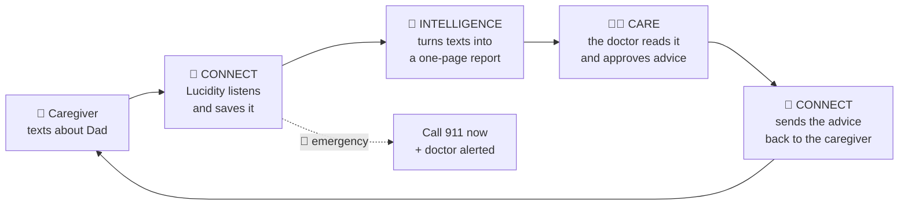

## How Lucidity works

- **Connect**: Lucidity talks with the family by text.
- **Intelligence**: Lucidity turns all those texts into one simple report.
- **Care**: a doctor reads the report and decides what advice to send back.
- **Emergencies**: Lucidity says "call 911" right away and alerts the doctor.
