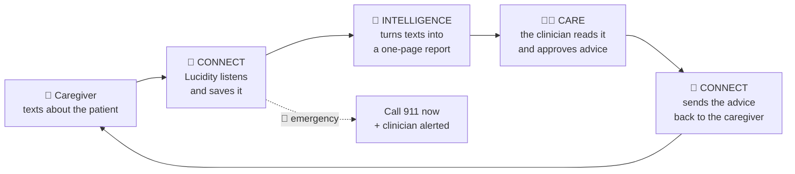

# Lucidity: How It Works

The "how": what happens to a text, how each feature works, where the code lives, and how to run and demo it. For the background and design rules, see [CONTEXT.md](CONTEXT.md).

---

## The big picture



Everything runs in **one Node process** (`npm run dev`). Both phones text Lucidity through **Photon Spectrum** (cloud iMessage). Lucidity tells the caregiver and the clinician apart by phone number: texts from `CLINICIAN_PHONE` are clinician commands; everyone else is a caregiver.

## What happens to every text

`src/index.ts` handles each incoming iMessage in this exact order:

1. **Skip** Lucidity's own messages and non-text messages (photos, etc.).
2. **From the clinician?** → clinician commands (Care). Never goes through caregiver handling.
3. **Safety check** (fixed rules, no AI). If it matches: send the fixed guidance immediately, alert the clinician, pause any check-in, hold reminders for an hour.
4. **STOP / START** (also UNSUBSCRIBE, CANCEL, END, QUIT / UNSTOP). Handled by code.
5. **Opted out?** Only safety replies go out; everything else gets "You're currently unsubscribed…".
6. **First message ever?** Send the welcome. If the message was only "hi", stop here.
7. **Check-in in progress, or a pending question** (resume, see-your-results, check-in-reminder offer, check-in offer)? Handled immediately by code, with no AI and no wait.
8. **Reply to a care-team message?** Saved, forwarded to the clinician. Short yes/skip answers are acknowledged by code; longer ones continue to the AI.
9. **Otherwise → the AI conversation**, after a 10-second wait so bursts of texts ("hey" / "dad got agitated" / "kept yelling") are handled as one message. One turn at a time per caregiver.

## Features

### Welcome (Connect) · `src/welcome.ts`
The first time a caregiver texts, Lucidity sends two warm messages, ending "What can I do for you today?". They're **written by the AI each time**, then **checked by code**: they must introduce Lucidity, mention the care team, reminders and STOP, end with an offer to help, and avoid promises like "monitoring 24/7". If a draft fails a check, or the AI is down, a fixed version is sent.

### Safety (Connect) · `src/triage.ts`
Keyword rules (stroke signs, breathing trouble, unresponsive, chest pain, seizure, serious fall, missing person, risk of harm, overdose, fall, sudden confusion, not eating or drinking, fever, caregiver crisis) produce two levels:
- **Emergency** → "This sounds like it could be an emergency. Please call 911 now." plus specific lines (missing person, stroke timing, 988, Poison Control).
- **Urgent** → "call your doctor today" plus specific lines.

The AI can also flag things the rules miss (e.g. "really drowsy, hard to keep her awake") via `escalate_urgent`; the caregiver still gets **fixed** text (`AI_ESCALATION_REPLY` + `AI_ESCALATION_FOLLOWUP`), never the AI's own words. Alerts are saved and texted to `CARE_TEAM_PHONE` (or `CLINICIAN_PHONE`). The rules favor catching too much over missing an emergency, so "he didn't fall" still triggers.

### Conversation (Connect) · `src/agent.ts`, `src/prompt.ts`, `src/llm.ts`
GLM-5.3 (via OpenCode; any OpenAI-compatible model works) replies warmly, asks one follow-up at a time, and saves what it hears through **tools**:

| Tool | Saves |
|---|---|
| `log_npi_observation` / `update_observation` | A behavior in one of the 12 NPI-Q categories, with severity/distress only if the caregiver gave them |
| `log_lucidity_episode` / `update_lucidity_episode` | A moment of unexpected clarity: duration, what was happening, what they said, how they were after |
| `log_general` | Hobbies (enjoyment vs ability), daily tasks, caregiver wellbeing, medical context, positive moments |
| `escalate_urgent` | An urgent concern the rules missed |
| `offer_questionnaire` | Offers the NPI-Q or ZBI |
| `set_reminder` / `change_reminder_time` / `cancel_reminder` | Reminders |
| `no_record_needed` | Small talk: nothing to save |

**Code guardrails** (each added after a real failure in testing):
- The first step **must** call a tool (a save, or `no_record_needed`), so the AI decides explicitly whether something is worth recording.
- Every tool input is validated (zod). Quotes must be the caregiver's real words.
- **Updates must cite words from the caregiver's latest message**, so the AI can't settle an old ambiguous answer on its own.
- "Skip" can decline at most one record per message.
- If a reply says "I've updated/saved/noted…" but nothing was saved, it's regenerated; if it happens again, a fixed clarifying question is sent instead.
- If a reply promises a reminder that wasn't scheduled, same treatment.
- Repeating reminders are only allowed if the caregiver said "every", "daily", and so on.
- Reasoning effort is set to **low** (`LLM_REASONING_EFFORT`): GLM's default thinking took 7–60+ seconds per reply; low takes about 2–8.

The AI sees the last 20 messages plus the caregiver's recent records (with ids), check-in status and scheduled reminders.

### Check-ins: NPI-Q and ZBI (Connect + Intelligence) · `src/questionnaire.ts`, `src/answers.ts`, `src/instruments/`
- **When offered:** code detects a cue and tells the AI "CUE MET, offer it now":
  - **NPI-Q:** 2+ different symptom types in the past 7 days.
  - **ZBI:** the caregiver described their own stress, or rated distress 4+.

  The ZBI wins if both cues are met. Not re-offered within 28 days (NPI-Q) or 14 days (ZBI), for 7 days after a "no", or more than once a day.
- **The handoff:** on "yes", code takes over and asks each question **word for word**, one at a time (NPI-Q: yes/no → severity → distress; ZBI: one 0–4 answer). Each answer is stored with the exact question shown and the raw reply.
- **Answers:** clear replies ("yes", "nah", "2", "sometimes") are parsed by rules. Unclear ones go to a small AI interpreter, which either maps them ("the wallet thing yeah" → Yes, confirmed back as "Got it: Yes.") or writes one clarifying line, after which the exact question is re-sent. Two unclear replies → marked unknown. "idk" is unknown, never no. A number sent to a yes/no question gets "This one is YES or NO first".
- **Controls:** SKIP, PAUSE, RESUME. An emergency or STOP pauses the check-in.
- **Finishing:** scores by code (NPI-Q severity 0–36 and distress 0–60; ZBI items 1–12, 0–48). Any unknown/skipped answer → "incomplete", no totals. The first time, the caregiver is asked whether to see results (remembered), then offered a recurring reminder to repeat the check-in (NPI-Q every 4 weeks, ZBI every 2 weeks, at 6 PM).

### Reminders (Connect) · `src/reminders.ts`
"Remind me to give Dad his meds at 8pm" → the AI calls `set_reminder` with a local time; **code** converts it to the caregiver's time zone (`LUCIDITY_TIMEZONE`, daylight-saving safe) and writes the confirmation. A timer checks every 20 seconds and texts "Reminder: give Dad his meds" through Spectrum. Supports one-time, daily, weekly, and every-N-days (check-in reminders). STOP holds reminders; emergencies hold them for an hour; late ones (bot was off) say "(this was due …)". Check-in reminders become invitations ("Want to do it now? Reply YES or NO"), so YES starts the check-in; they're skipped if the check-in was just done.

### The profile (Intelligence) · `src/profile.ts`
Compiled **entirely by code** when the clinician asks. It contains:
- NPI-Q changes between the last two check-ins (per symptom and totals)
- how many ZBI items rose
- the caregiver's own words for the most-reported symptoms
- lucid moments and safety alerts
- up to 3 **suggested questions**, each with its reason (e.g. the biggest NPI-Q rise → "Does Dad's anxiety tend to happen at a particular time of day?")

Synthetic data is labeled.

### Drafting (Intelligence) · `src/drafting.ts`
When the clinician writes a note ("tell them: create a calm environment and remove environmental triggers"), the AI turns it into short, warm caregiver wording ("Dad's anxiety sounds really hard tonight. One thing that can help is making his space calm… Want to try it? Reply YES, or skip."). Code checks the ending, the length, and that no medication language was added. The clinician sees the draft next to the original note.

### Clinician commands (Care) · `src/care.ts`
Plain phrases, any capitalization, understood by rules (no AI):

| Clinician types | Does |
|---|---|
| `how is he doing?` / `profile` | The profile |
| `ask 1` | Drafts suggested question 1 |
| `ask them: …` / `tell them: …` | Drafts a question / recommendation (AI-worded, original note shown) |
| `send it` / `looks good` / `yes` | Approves and sends the draft |
| `change it to: …` / `use my words` / `never mind` | Edit, send the note as typed, cancel |
| `any replies?` / `help` | Status of sent messages / the command list |

**Nothing is sent without approval.** Approved text arrives as "Question from Dad's care team: …" or "From Dad's care team: …", exactly as approved, and isn't sent if the caregiver opted out. The clinician also gets safety alerts and "New update for Jonathan… Reply 'profile'" nudges: after every check-in, and at most once an hour for new behaviors.

## Saved data

Everything is in **`data/lucidity.json`** (git-ignored; delete it, with the bot stopped, to reset). The bot keeps it in memory and rewrites the file on every change, so deleting it while running does nothing.

| Key | Holds |
|---|---|
| `caregivers` | Per phone: chat history (last 40), opted out, patient name/label, score consent, pending offers/prompts, time zone, last emergency |
| `observations` | NPI-Q behaviors: category, severity, distress, quote, period, revisions |
| `lucidityEpisodes`, `notes` | Lucid moments; general notes (hobbies, wellbeing…) |
| `alerts` | Safety alerts: level, source (rules/ai), reasons, text |
| `assessments` | Check-ins: every question shown, raw reply, value, status, scores |
| `reminders` | What, when (UTC), time zone, repeat, status |
| `careMessages` | Clinician questions/recommendations: draft text, note, status, reply |

## Code map

| File | Role |
|---|---|
| `src/index.ts` | Startup, routing (the order above), sending, alerts |
| `src/triage.ts` | Safety rules and fixed wording |
| `src/welcome.ts` | First-time welcome |
| `src/agent.ts`, `src/prompt.ts`, `src/llm.ts` | AI conversation, tools, guardrails, model connection |
| `src/debounce.ts` | 10-second burst grouping |
| `src/questionnaire.ts`, `src/answers.ts`, `src/instruments/` | Check-ins, answer parsing, NPI-Q/ZBI structure and scoring |
| `src/reminders.ts` | Scheduling, time zones, delivery timer |
| `src/profile.ts`, `src/drafting.ts` | Profile and suggested questions; AI wording drafts |
| `src/care.ts` | Clinician commands, approval, delivery, reply capture |
| `src/store.ts` | Saved data |
| `src/scripts/llm-check.ts`, `src/scripts/demo-seed.ts` | Model connection test; synthetic demo history |
| `src/*.test.ts` | 114 tests (mock model, no API calls) |

## Running it

**Always use an Ubuntu (WSL) terminal in `~/lucidity`, not PowerShell.**

```bash
npm install
cp .env.example .env      # then fill it in (see below)
npm run llm:check         # expect "✓ Tool call OK"
npm run dev               # wait ~30s for "Spectrum started"
npm test                  # 114 tests
```

`.env` (never commit it):

| Variable | Value |
|---|---|
| `PROJECT_ID`, `PROJECT_SECRET` | Photon project credentials |
| `LLM_BASE_URL` | `https://opencode.ai/zen/go/v1` |
| `LLM_API_KEY` | OpenCode key |
| `LLM_MODEL` | `glm-5.3` |
| `CLINICIAN_PHONE` | The clinician's phone, e.g. `+15551234567` |
| Optional | `LLM_REASONING_EFFORT` (default low), `LUCIDITY_TIMEZONE` (default America/New_York), `CARE_TEAM_PHONE`, `DEMO_CAREGIVER_PHONE`, `BURST_WINDOW_MS` (default 10000; 3000 is snappier for videos) |

Questionnaire wording must be in `data/instruments/npiq.local.json` and `zbi.local.json` (templates in `docs/instruments/`); startup logs `Check-ins enabled: NPI-Q, ZBI.`

## Demo

**Setup** (bot stopped):
```bash
rm data/lucidity.json
npm run demo:seed -- --caregiver +1YOURNUMBER   # Jonathan's synthetic September check-ins
npm run dev
```
The live check-in becomes "October", so the profile compares September to October for real (severity 6 → 12, distress 8 → 18 with the answers below). Don't use `--full` if you want to do a check-in live: it also seeds an October check-in, which blocks new offers for 28 days.

Each person texts **their own assigned Lucidity line** (the  number next to their name under **Users** in the Photon dashboard).

| # | Who | Text | Shows |
|---|---|---|---|
| 1 | Caregiver | `hi` | AI welcome |
| 2 | Caregiver | `dad's had a rough week. tonight he's so anxious, he keeps trying to get up and leave` | Conversation; clinician nudged |
| 3 | Caregiver | `he was up pacing the halls at 3am again too` | Check-in offered |
| 4 | Caregiver | `yes`, then: no · no · no · yes 2 3 · `yeah definitely` 3 5 · no · yes `somewhere in the middle` 2 · no · no · yes 3 4 · yes 2 4 · no | NPI-Q, casual answers |
| 5 | Caregiver | `yes` (results), `yes` (repeat reminder) | Code scores; recurring reminder |
| 6 | Caregiver | `remind me to give dad his meds at <2 min from now>` | Reminder arrives later |
| 7 | Clinician | `how is he doing?` | The profile |
| 8 | Clinician | `ask 1` → `send it` | Approval gate, delivery |
| 9 | Caregiver | `usually right after dinner` | Reply forwarded |
| 10 | Clinician | `tell them: create a calm environment and remove environmental triggers` → `looks good` | AI drafting, approval |
| 11 | Caregiver | `yes` | Reply forwarded |
| 12 | Caregiver | `he fell and hit his head` | Fixed 911 text + clinician alert |

## Gotchas we hit

| Problem | Fix |
|---|---|
| `'tsx' is not recognized` | You're in PowerShell. Use the Ubuntu terminal. |
| "Target not allowed for this project" when Lucidity texts someone first | Free/Pro Photon plans only text people registered under **Users** in the Photon dashboard. A newly added number can take a few minutes to start working. If it still fails, check the handle Apple really uses at debug.photon.codes. |
| Replies time out or take a minute | `LLM_REASONING_EFFORT` must be `low` (the default). |
| OpenCode returns 400 "missing x-opencode-session" | Already handled in `src/llm.ts`; every request sends a session header. |
| Clinician gets chatty AI replies | Their number doesn't match `CLINICIAN_PHONE`, or the bot wasn't restarted after setting it. |
| Deleting `data/lucidity.json` doesn't reset | Stop the bot first; it rewrites the file from memory. |
| Reminders don't fire | The bot must be running at that time (it runs on a laptop). |
| `spectrum.imessage.profile-sync … ETIMEDOUT` in the log | A harmless Photon background feature; ignore it. |
| No check-in offered | Only one offer per day; NPI-Q not within 28 days of the last; a recent "no" blocks it for 7 days. Reset data to test again. |
