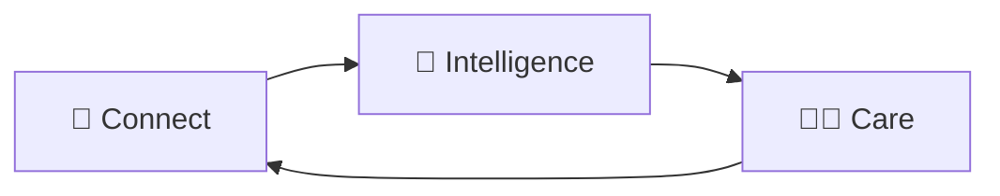

## 🧠 What Lucidity solves

> **Dementia care happens at home, but doctors only see the patient for a few minutes every few months, so they rely on what an exhausted caregiver can remember.**
> **Lucidity lets caregivers simply text what they notice, and turns those messages into a clear picture the care team can act on.**

### Three layers

| 💬 Connect | 🧠 Intelligence | 👩‍⚕️ Care |
|:---:|:---:|:---:|
| talks with the family | understands what's happening | the clinician decides |
